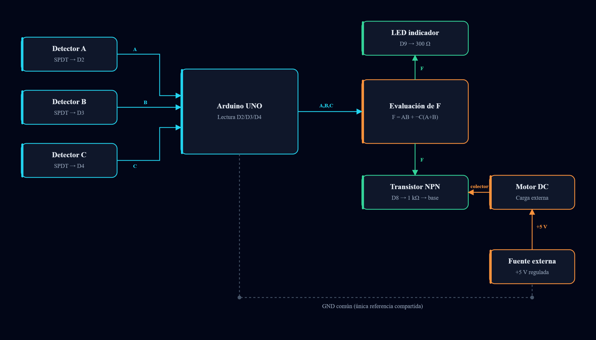
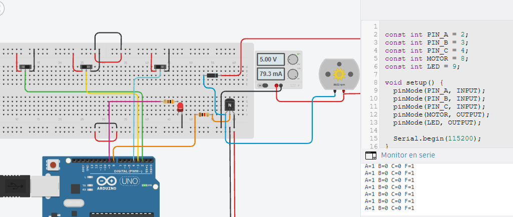
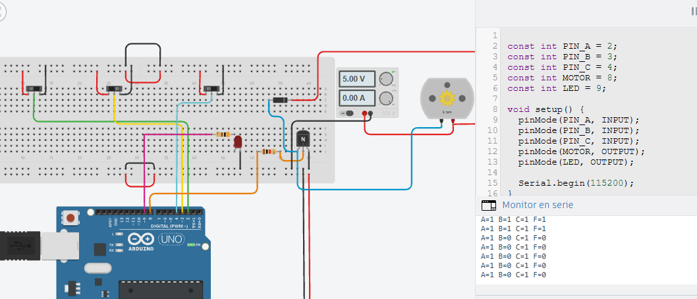

<div align="center">


### Esquema eléctrico del sistema


# EIC901 · Sistema de extinción por votación 2 de 3

### Arduino UNO R3 · C++ · Simulación en Tinkercad


**Universidad Don Bosco · EIC901 · Etapa 2 · Ciclo 02-2026**

[**Simular circuito**](https://www.tinkercad.com/things/4VEX9vVvEAo-eic901etapa2sistemaextincionarduinocpp?sharecode=oYl9HFb9AblIeLe8uCefzoiCKroxj-k_aQ0VEF1MGRA) · [**Explorar diagramas**](web/diagramas/) · [**Código Arduino**](firmware/arduino/EIC901_Etapa2_Arduino_CPP/EIC901_Etapa2_Arduino_CPP.ino) · [**Evidencias**](capturas/04_pruebas/)

</div>

---

## Descripción

Prototipo universitario que representa un sistema de extinción para un cuarto de servidores. Tres interruptores SPDT simulan señales de detección y un **Arduino UNO R3** ejecuta la lógica de votación para activar un **LED rojo** y un **motor DC** a través de un transistor NPN.

La entrada **C** representa un detector de lazo normalmente cerrado: `C=1` indica condición normal y `C=0` representa alarma o interrupción del lazo. El motor simula el actuador del sistema; no representa una instalación real certificada.

## Arquitectura y diagramas



Los diagramas siguientes documentan el diseño y la lógica del prototipo; la referencia para la conexión eléctrica comprobada es el montaje de Tinkercad.

|Diagrama|Visualización|
|-|-|
|**Arquitectura**|[Ver arquitectura](documentacion/diseno/arquitectura-sistema.png)|
|**Flujo del firmware**|[Ver diagrama de flujo](documentacion/diseno/diagrama-flujo.png)|
|**Esquema visual ilustrativo**|[Ver esquema](documentacion/diseno/esquema-electrico.png)|
|**Tabla de verdad visual**|[Ver diagrama](documentacion/diseno/tablaDVerdad.png)|

> **Alcance:** el esquema incluido es una representación gráfica documental. Para reproducir conexiones, utilizar el circuito funcional de Tinkercad y verificar eléctricamente cada nodo. No utilizar esta documentación para construir un sistema de protección contra incendios de uso real.

## Función lógica

\[
F = AB + \overline{C}(A + B)
]

Código correspondiente:

```cpp
int F = (A && B) || (!C && (A || B));
```

### Tabla de verdad verificada

|A|B|C|F|LED|Motor|
|:-:|:-:|:-:|:-:|-|-|
|0|0|0|**0**|Apagado|Detenido|
|0|0|1|**0**|Apagado|Detenido|
|0|1|0|**1**|Encendido|Girando|
|0|1|1|**0**|Apagado|Detenido|
|1|0|0|**1**|Encendido|Girando|
|1|0|1|**0**|Apagado|Detenido|
|1|1|0|**1**|Encendido|Girando|
|1|1|1|**1**|Encendido|Girando|

**Resultado en Tinkercad: 8/8 combinaciones comprobadas**, con monitor serial, LED y motor.

## Componentes y asignación de pines

|Elemento|Conexión principal|
|-|-|
|Interruptores SPDT A, B y C|COM → D2, D3 y D4; selección entre 5 V lógico y GND|
|LED rojo|D9 → resistencia 300 Ω → ánodo; cátodo → GND|
|Transistor NPN BJT|D8 → resistencia 1 kΩ → base B; emisor E → GND|
|Motor DC|Positivo → fuente externa regulada de 5 V; negativo → colector C|
|Diodo rectificador flyback|En paralelo con motor: cátodo al positivo, ánodo al colector|
|Referencia de tierra|GND del Arduino unido al negativo de la fuente externa; positivos independientes|

El transistor y el diodo del simulador son componentes genéricos. Las mediciones observadas no garantizan el dimensionamiento de una implementación física.

## Evidencias del prototipo

<div align="center">

**Motor activado · combinación 100**



**Motor desactivado · combinación 101**



</div>

|Estado|Fuente|Corriente mostrada|Motor|
|-|-|-|-|
|`F=0`|5,00 V|0,00 A|0 rpm|
|`F=1`|5,00 V|aprox. 79,3 mA|Girando|

Las lecturas corresponden a la simulación. La corriente de arranque y las características de una carga física deben verificarse por separado.

**Evidencias:** [entradas](capturas/01_entradas/) · [programa](capturas/02_programa/) · [potencia](capturas/03_potencia/) · [ocho pruebas](capturas/04_pruebas/).

## Aplicación web interactiva

El repositorio incluye una aplicación **React + TypeScript + Vite** que permite explorar:

* Arquitectura del sistema.
* Diagrama de flujo.
* Esquema visual.
* Tabla de verdad interactiva.

Para ejecutarla localmente se requiere **Node.js** y **npm**:

```bash
cd web/diagramas
npm ci
npm run dev
```

Abrir `http://localhost:5173/` o utilizar el archivo `web/diagramas/INICIAR_EN_WINDOWS.bat` en Windows.

Esta aplicación presenta diagramas y una visualización lógica; no sustituye la simulación eléctrica.

## Proyecto Tinkercad

[**Abrir el circuito y ejecutar la simulación**](https://www.tinkercad.com/things/4VEX9vVvEAo-eic901etapa2sistemaextincionarduinocpp?sharecode=oYl9HFb9AblIeLe8uCefzoiCKroxj-k_aQ0VEF1MGRA)

El código principal se encuentra en [`firmware/arduino/EIC901_Etapa2_Arduino_CPP/`](firmware/arduino/EIC901_Etapa2_Arduino_CPP/). No requiere librerías externas adicionales.

## Organización del repositorio

```text
assets/                         Portada del proyecto
capturas/                       Entradas, código, potencia y pruebas
circuitos/tinkercad/            Referencia a la simulación
firmware/arduino/               Firmware Arduino C++
documentacion/diseno/           Diagramas técnicos
pruebas/                        Tabla de verdad y registro
web/diagramas/                  Aplicación interactiva React
```

---

<div align="center">

**EIC901 · Etapa 2 · Sistema de extinción por votación 2 de 3**

*Prototipo académico validado en Tinkercad.*

</div>

